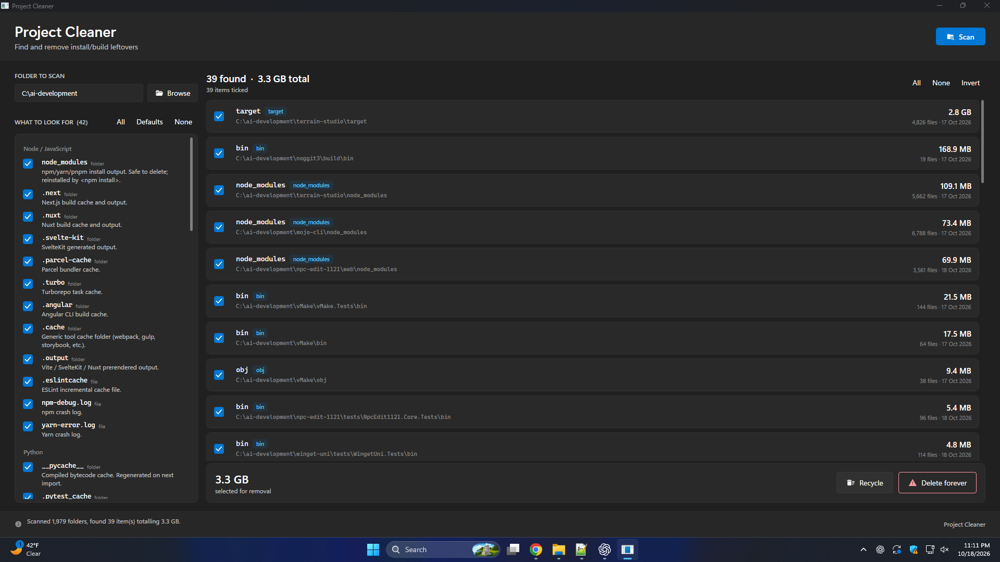
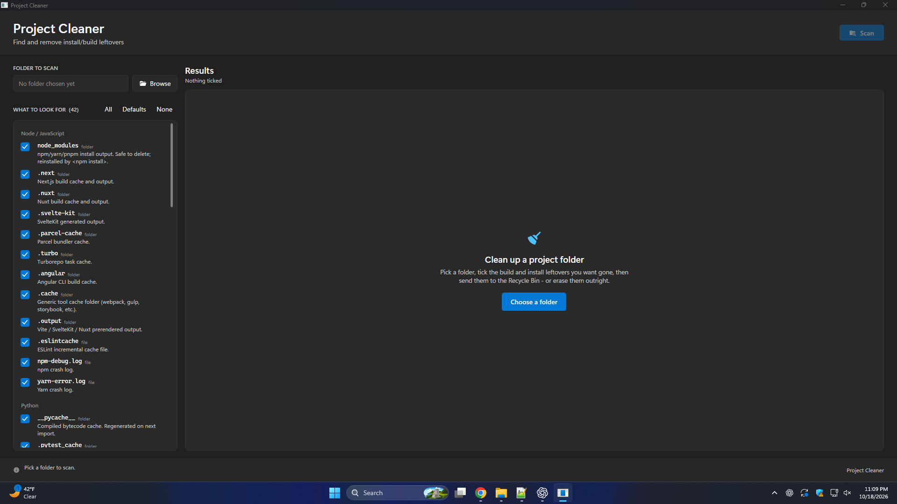
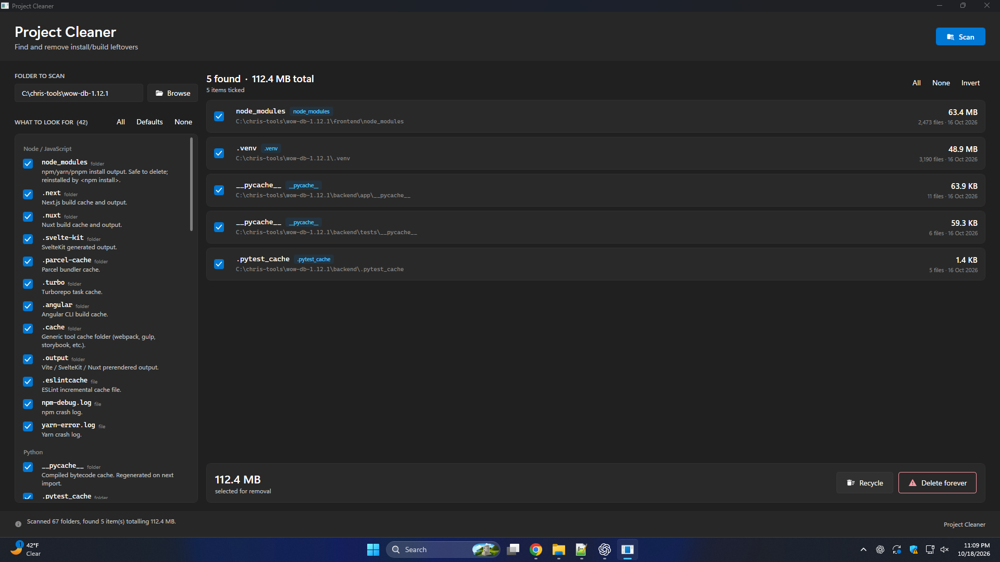

# Project Cleaner

**Find and remove install/build leftovers on Windows.**

Created by **Chris Bunting**.

Project Cleaner walks a folder tree, finds the build caches, package installs and OS cruft that
accumulate underneath it, shows you exactly what it found and how big it is, and then removes
what you tick — to the Recycle Bin, or permanently.

It never deletes anything you did not explicitly select, and it will not touch a path that falls
outside the folder you scanned.



---

## Screenshots

**Starting point** — nothing scanned yet, with the full pattern catalogue ready on the left.



**A small project** — 5 items, 112.4 MB, ticked and ready to clean.



**A large tree** — 39 items, 3.3 GB, sorted largest-first so the biggest wins are at the top.


---

## How it works

1. **Pick a folder.** The native Windows folder picker sets the scan root.
2. **Choose what to look for.** 52 built-in patterns across 9 categories. 42 are on by default;
   the 10 with names generic enough to collide with real source are opt-in.
3. **Scan.** Matches stream into the list as they are discovered, sorted largest-first, with size,
   file count and last-modified date for each.
4. **Tick what you want.** Per item, or All / None / Invert in bulk. The footer totals what is ticked.
5. **Delete.** *Recycle* (recoverable) or *Delete forever*. Both confirm first, both are
   cancellable mid-run, and both report per-path failures afterwards.

---

## The pattern catalogue

52 patterns in 9 categories. **Opt-in** means the name is generic enough that it can match real
source, so it ships unchecked — enable it only if you know what you want.

| Category | Pattern | Type | Removes | |
|---|---|---|---|---|
| **Node / JavaScript** | `node_modules` | folder | npm/yarn/pnpm install output | default |
| | `.next` | folder | Next.js build cache and output | default |
| | `.nuxt` | folder | Nuxt build cache and output | default |
| | `.svelte-kit` | folder | SvelteKit generated output | default |
| | `.parcel-cache` | folder | Parcel bundler cache | default |
| | `.turbo` | folder | Turborepo task cache | default |
| | `.angular` | folder | Angular CLI build cache | default |
| | `.cache` | folder | Generic tool cache (webpack, gulp, storybook) | default |
| | `.output` | folder | Vite / SvelteKit / Nuxt prerendered output | default |
| | `.eslintcache` | file | ESLint incremental cache | default |
| | `npm-debug.log` | file | npm crash log | default |
| | `yarn-error.log` | file | Yarn crash log | default |
| **Python** | `__pycache__` | folder | Compiled bytecode cache | default |
| | `.pytest_cache` | folder | pytest last-failed / node-id cache | default |
| | `.mypy_cache` | folder | mypy incremental type cache | default |
| | `.ruff_cache` | folder | Ruff linter cache | default |
| | `.tox` | folder | tox virtualenv + work dirs | default |
| | `.nox` | folder | nox session directories | default |
| | `.ipynb_checkpoints` | folder | Jupyter autosave checkpoints | default |
| | `.venv` | folder | Python virtual environment | default |
| | `venv` | folder | Python virtual environment (older convention) | default |
| | `*.egg-info` | folder | setuptools package metadata | default |
| | `*.pyc` | file | Compiled Python bytecode | default |
| | `*.pyo` | file | Optimised Python bytecode | default |
| **.NET / C#** | `bin` | folder | MSBuild output | default |
| | `obj` | folder | MSBuild intermediate folder | default |
| | `.vs` | folder | Visual Studio solution cache | default |
| | `TestResults` | folder | Test run output (TRX, coverage, logs) | default |
| | `*.user` | file | Visual Studio per-user settings | default |
| | `packages` | folder | Legacy NuGet restore folder | **opt-in** |
| **Java / JVM** | `.gradle` | folder | Gradle caches and build state | default |
| | `.m2` | folder | Maven local repository | **opt-in** |
| | `build` | folder | Gradle / Maven build output | **opt-in** |
| **PHP** | `vendor` | folder | Composer install output | default |
| **Rust / Go** | `target` | folder | Cargo build output and incremental cache | default |
| | `.gocache` | folder | Go build cache | default |
| **IDE / editor** | `.fleet` | folder | JetBrains Fleet state/cache | default |
| | `.history` | folder | VS Code local history | default |
| **Build output** | `coverage` | folder | Test coverage report output | default |
| | `.nyc_output` | folder | Istanbul raw coverage data | default |
| | `.sass-cache` | folder | Sass compiler cache | default |
| | `DerivedData` | folder | Xcode derived data | default |
| | `dist` | folder | Distribution / bundle output | **opt-in** |
| | `out` | folder | Generic compiler output folder | **opt-in** |
| | `.terraform` | folder | Terraform provider/plugin cache and state | **opt-in** |
| **OS cruft** | `.DS_Store` | file | macOS folder metadata | default |
| | `Thumbs.db` | file | Windows Explorer thumbnail cache | default |
| | `*.tmp` | file | Temporary file | default |
| | `desktop.ini` | file | Folder customisation file | **opt-in** |
| | `*.log` | file | Log file | **opt-in** |
| | `*.bak` | file | Backup file | **opt-in** |
| | `*.old` | file | Rotated / superseded file | **opt-in** |

Matching is **case-insensitive and name-only** — a pattern is tested against the entry's file
name, never against its full path. Patterns containing `*` or `?` are treated as globs.

---

## Safety

A tool that deletes things has to be boring about it. These are the guarantees:

- **Nothing outside the scan root is ever deleted.** Every selected path is re-checked against the
  root immediately before the delete runs, and the operation is refused outright if any item sits
  outside it — including the root itself.
- **Symlinks and junctions are never followed.** The scan cannot escape the folder you picked, and
  cannot loop forever on a cycle.
- **A matched folder is not descended into.** Nested matches cannot double-count, and deleting a
  200k-file `node_modules` is one operation rather than a walk of its contents.
- **Every delete confirms first.** The dialog shows the item count, the total size, and the first
  eight paths, with the irreversible action rendered in red.
- **Recycle mode lets Windows ask.** It deliberately omits the "no confirmation" flags, so if an
  item is too large for the Recycle Bin, Windows prompts you rather than quietly erasing it.
- **Success is verified, not assumed.** A path is reported as deleted only after confirming it is
  actually gone — the shell occasionally reports success for work it merely queued.
- **Failures are explained per path.** Locked files, read-only items and permission problems are
  listed with the reason, instead of a silent partial clean.
- **Stop works mid-operation.** Both scanning and deleting are cancellable, and already-removed
  items are reported accurately when you stop early.
- **A crash cannot lose your data.** Unhandled background exceptions surface a dialog and keep the
  window alive rather than tearing down the process.

---

## Requirements

| | |
|---|---|
| **OS** | Windows 10 build 17763 (1809) or later, Windows 11 |
| **Runtime** | [.NET 10 Desktop Runtime](https://dotnet.microsoft.com/download/dotnet/10.0) |
| **To build** | .NET 10 SDK (developed against 10.0.402) |

Windows-only by design — Recycle Bin access goes through the Windows shell, and the UI follows the
Windows 11 light/dark app-mode setting.

---

## Building and running

```powershell
dotnet restore
dotnet build -c Release
dotnet run
```

The executable lands at:

```
bin\Release\net10.0-windows10.0.17763.0\ProjectCleaner.exe
```

To publish a self-contained build that runs without the .NET runtime installed:

```powershell
dotnet publish -c Release -r win-x64 --self-contained true
```

The only dependency is **MaterialDesignThemes 5.3.2** (pack icons and the dialog host). WinUI-styled
resource dictionaries for the palette, controls and typography live in `Theme/`, so there is no
runtime theme package beyond that.

---

## Project layout

```
ProjectCleaner/
├── Models/            Catalog, matches, targets, results, byte formatting
│   └── PatternCatalog.cs      the 52 built-in patterns
├── Services/          Scan, delete, theme, folder picking
│   ├── ScannerService.cs       iterative tree walk
│   └── ShellDeleteService.cs   IFileOperation / filesystem deletion
├── ViewModels/
│   └── MainViewModel.cs        window state and commands (MVVM)
├── Views/
│   └── ConfirmDeleteDialog.*   pre-delete confirmation
├── Interop/           Shell and DWM P/Invoke
├── Theme/             Win11 palette, controls, typography
├── Infrastructure/    ObservableObject, RelayCommand
└── MainWindow.xaml    single-window UI
```

---

## Implementation notes

A few decisions worth knowing if you are reading the source:

- **The scan is iterative, not recursive** — an explicit stack, so a deeply nested tree cannot
  overflow the CLR stack. Unreadable folders are skipped rather than aborting the whole scan.
- **Permanent deletes go to the filesystem API first.** The shell charges a flat ~95 ms per
  directory queued, regardless of flags or mode, which swamps a scan matching many small folders —
  200 empty folders took 20.6 s through the shell and 48 ms through `Directory.Delete`. Anything the
  filesystem refuses (a junction or read-only file inside the tree, a lock, a permission) is handed
  to `IFileOperation`, which is what copes with those.
- **The shell operation runs on a dedicated STA thread.** `IFileOperation` is apartment-affine and
  thread-pool threads frequently arrive as MTA, so the worker thread is created explicitly.
- **The UI thread only ever touches results.** Scanning, measuring and deleting all run off the
  dispatcher, and matches are streamed back as they are found so the list fills live.
- **Theme is applied once at startup**, following the OS app-mode setting. There is deliberately no
  runtime light/dark toggle: rewriting ~33 palette entries against a live window floods the
  dispatcher with resource re-resolution and the UI stops responding.

---

## License

MIT © Chris Bunting — see [LICENSE](LICENSE).